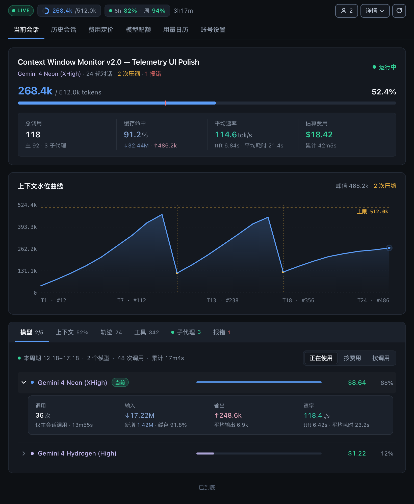
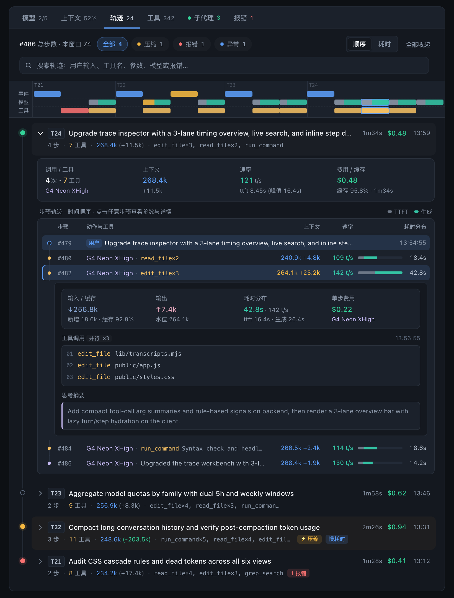
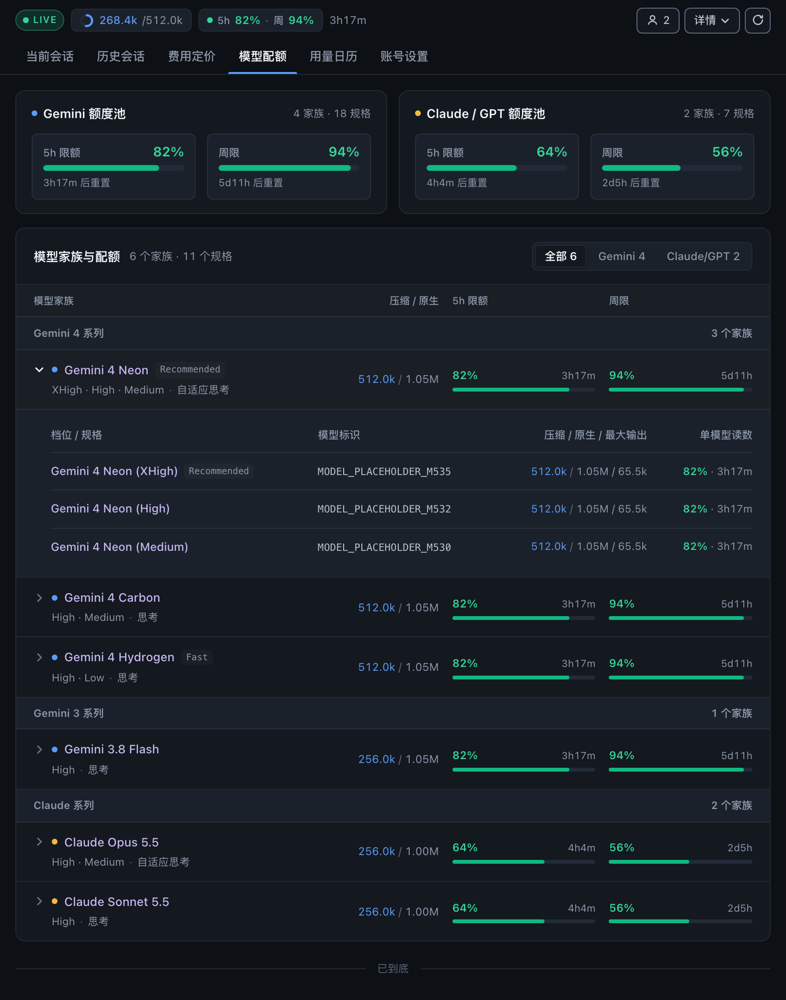
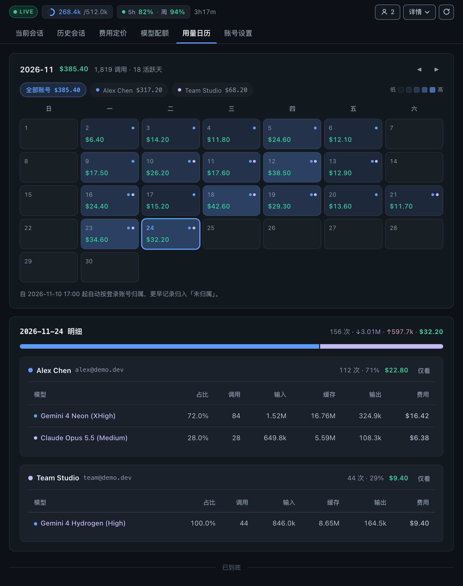

# Antigravity Context Window Monitor

轻量级、按需计算的 Antigravity 原生侧边栏监控插件（基于 `sidecar_sdk`），提供当前会话上下文水位、计费周期模型监控、轮次执行轨迹与耗时瀑布流、子代理追踪、模型配额池与按账号拆分的用量日历。

## 界面预览

### 当前会话总览 & 计费周期活跃模型

顶部实时 HUD 微圆环与 `5h` / `周限` 双窗口配额胶囊、`200k` 长上下文阶梯刻度、4 列核心 KPI、带压缩节点的上下文水位曲线，以及默认展示当前计费周期的「正在使用」模型列表：



### 执行轨迹 & 三泳道时间总览

顶部 `事件 / 模型 / 工具` 三泳道交互总览条（支持「顺序 / 耗时」双视角、悬浮预览与点击双泳道高亮定位）、穿透折叠轮次的实时搜索与规则异常诊断（`慢耗时` / `缓存骤降` / `高频重复`）；Prompt-first 轮次大纲展开后按时间正序展示步骤瀑布与原地展开的单步详情检视卡（含输入/缓存、TTFT/生成拆分、编号并行工具调用与思考摘要）：



### 模型配额池 & 家族双窗口矩阵

Gemini / Premium 额度池 `5h` + `周限` 双窗口余量与重置倒计时，以及按模型家族聚合的压缩/原生上下文规格矩阵（支持按家族展开各档位变体）：



### 用量日历 & 多账号拆分

月度热力图日历与账号切号自动归属，单日明细按账号纵向分组展示分模型 Token 与估算费用：



## 核心特性

- **零依赖、零后台轮询（空闲 0% CPU）**：仅在监控面板可见时按需请求计算；后端采用 SQLite WAL 指纹缓存、活跃会话字节偏移增量读取与 `?v=` 条件短路（空闲轮询仅返回 41 B），前端支持 `localStorage` SWR 秒开与轮次/步骤双层按需懒渲染。
- **当前会话全维度监控**：
  - **上下文水位与曲线**：带 `200k` 长上下文阶梯刻度、压缩节点标记与上下文构成拆分。
  - **模型（默认「正在使用」）**：按实时额度池周期自动过滤当前计费周期内活跃模型，支持切换「正在使用 / 按费用 / 按调用」，展开展示调用、输入（新增 + 缓存命中）、输出与速率（`tok/s`、`ttft`、平均耗时）。
  - **执行轨迹（三泳道总览 + 耗时瀑布 + 单步检视器）**：三泳道（`事件 / 模型 / 工具`）顺序/耗时切换与点击定位跳转、实时穿透搜索、本地零开销异常标记（`慢耗时` / `缓存骤降` / `高频重复`），轮内按时间正序展示双段 `TTFT` / 流式生成耗时瀑布与可原地展开的单步参数/并行工具/思考详情卡。
  - **工具排行 / 子代理 / 报错分类**：主会话与全部子代理联合统计、运行状态高亮与错误分类过滤。
- **全局历史、费用与日历**：
  - **历史会话**：搜索、筛选运行中会话、按最近 / 费用 / 水位排序，支持一键跳转查看。
  - **费用与单价配置**：支持 1d / 7d / 31d / 90d 每日趋势、按模型系列与账号拆分，支持自定义单价覆盖并恢复官方价。
  - **模型配额**：Gemini / Premium 双窗口（`5h` + `周限`）额度池与按模型家族聚合的压缩/原生窗口规格矩阵。
  - **用量日历**：热力图日历 + 多账号自动切号归属，单日明细按账号纵向分组展示。
- **深浅双色主题 & 多语言**：Obsidian Slate 深色默认 + 自动适配浅色系统主题；支持中文 / English / 双语实时切换。
- **极简持久化**：仅在 `$ANTIGRAVITY_EXECUTABLE_DATA_DIR/accounts.json`（通常 `< 5 KB`）保存账号配额快照、自定义单价与语言偏好。

## 安装方式

将本仓库克隆至 Antigravity 本地插件目录并启用即可：

```bash
git clone https://github.com/lvjg/antigravity-context-monitor.git ~/.gemini/config/plugins/antigravity-context-monitor
```

在聊天中打开监控侧栏：

```markdown
[Context Window Monitor](sidecar://antigravity-context-monitor/monitor/)
```

## 目录结构

```text
.
├── plugin.json                     # Antigravity 插件清单
├── assets/logo.svg                 # 插件图标
├── skills/context-window-monitor/  # 呼起面板的 Skill 说明
└── sidecars/monitor/
    ├── sidecar.json                # sidecar_sdk 声明（右侧辅助面板入口）
    ├── main.mjs                    # HTTP/API 路由入口
    ├── lib/
    │   ├── ls-client.mjs           # 分层 Language Server 客户端（容错降级）
    │   ├── transcripts.mjs         # 增量 transcript.jsonl 解析与周期聚合
    │   ├── pricing.mjs             # 模型规格、压缩上限与费率计算
    │   └── store.mjs               # 轻量 accounts.json 偏好存储
    └── public/                     # 原生零构建前端（index.html / styles.css / app.js）
```

## 致谢

部分视觉层级与排版灵感参考自 [AGI-is-going-to-arrive/Antigravity-Context-Window-Monitor](https://github.com/AGI-is-going-to-arrive/Antigravity-Context-Window-Monitor)。
